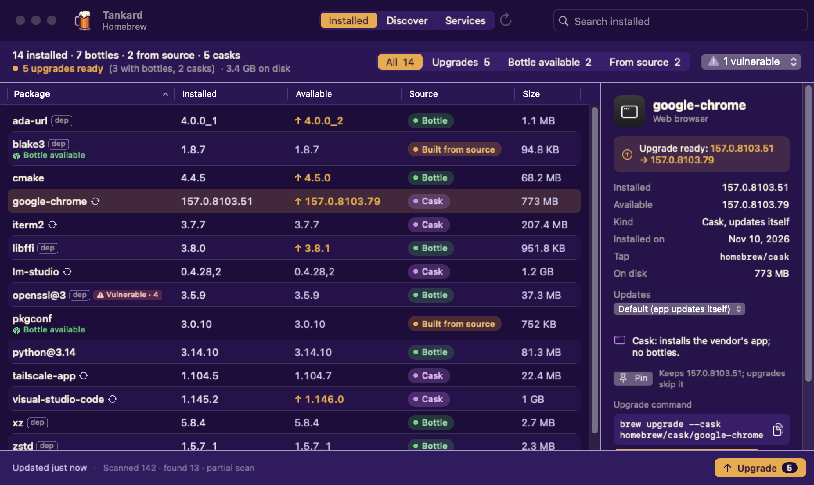

<p align="center"></p>

# Tankard

<p>
<a href="https://github.com/d4rkwyng/tankard/releases/latest"></a>
<a href="https://github.com/d4rkwyng/homebrew-tap/blob/main/Casks/tankard.rb"></a>


<a href="LICENSE"></a>
</p>

A native macOS app for Homebrew, for macOS 14 Sonoma and later, Intel and Apple silicon.
It shows what you have installed, how each package got there, and what's ready to
upgrade, and runs brew for you when you click. When the Mac uses
[Intelbrew](https://github.com/d4rkwyng/intelbrew) (Homebrew with prebuilt Intel
bottles), Tankard shows whose bottle each package came from and whether Homebrew is on
the Intelbrew forks.



## What it does

- **Installed**: every formula and cask with a badge for how it got there (Intelbrew or
  Homebrew bottle, built from source, newer than the tap, no bottle yet, cask), filters,
  search, and the exact brew command for each action.
- **Upgrades** one package at a time with a live log, Stop After Current and Stop Now
  (on every sheet; brew undoes the unfinished step). Several packages download in
  parallel first ("Downloading 4 of 9…"). Tankard waits for a brew running elsewhere
  instead of failing, offers Retry with a next step when one fails, asks before quitting
  mid-run, and offers the rest of an interrupted run at the next launch. Upgrades with no
  bottle for your Mac are marked "will compile from source" before anything starts, with
  an option to skip them; in Intelbrew mode they say how long the build took on the
  Intelbrew builder.
- **Discover**: search every formula and cask and install. Formulae with a bottle for
  your Mac come first; ones that would compile say so and ask before installing. The
  details show Homebrew's public install counts for the last 30, 90 and 365 days. Paste a
  `brew install …` command into either search field; an Installed search with no match
  offers **Search Discover**.
- **Adopt Apps** (Homebrew menu): apps you installed by hand that a cask also installs
  can be handed to Homebrew (`brew install --cask --adopt`), so brew keeps them up to
  date. Tankard says how sure each match is, ticks only good matches, and says before
  anything runs that uninstalling the cask afterwards deletes the app.
- **Clean Up**: see what `brew cleanup` would remove and how much space it frees, then
  run it.
- **Replace with Bottle**: a package you built from source whose version has a bottle
  gets swapped for the bottle in one click.
- **Uninstall**, blocked (with the reasons listed) while other packages need it, or
  while it is pinned (**Unpin and Uninstall** does both). Dependencies that nothing else
  would need afterwards are listed, with **Also remove these** (on by default).
- **Pin** packages so upgrades skip them, filter by **Pinned** or **Installed by you**, and
  follow **Depends on**, **Used by** and the dependency tree from package to package.
- **Services**: see `brew services` status and start, stop or restart your own services.
- **Automatic updates** (optional, off by default): bottles only, on a daily or weekly
  schedule while the Mac is idle and on AC power, skipping pinned packages and running apps.
- **Restore points** before every upgrade, with rollback of formulae whose previous version
  you kept.
- **Taps**: see, add and remove taps, and set Homebrew 7's trust for third-party ones.
- **Casks that need your administrator password** (`.pkg` installers) install and upgrade
  through a Tankard password dialog; the password goes straight to sudo and is never stored.
- **Health and History**: `brew doctor` warnings explained in plain English, the
  `HOMEBREW_*` settings brew gets (Health ▸ Environment), and every
  brew command Tankard ran, with Retry. **Brewfiles**: export one, or check what a
  Brewfile needs that this Mac doesn't have.
- **Homebrew menu**: revert from Intelbrew to standard Homebrew, or uninstall the Homebrew
  Tankard shows (its prefix only), both in Terminal after showing every command.
- **Vulnerabilities** from `brew vulns` (Homebrew 7): a ⚠ tag with severity, the advisory
  ids linked to OSV.dev, "fixed in", a Vulnerable filter and "Upgrade vulnerable
  packages". Scans run when you ask, or on every refresh if you opt in (brew sends your
  formula names and versions to OSV.dev). brew reports most scans as partial, and Tankard
  says so.
- **Notes from brew** (caveats) in each package's details, a "Has notes" filter, and a
  one-time "Post-install notes" sheet after an install or upgrade.
- **Size on disk** per package (a sortable column) and in total, from `brew info --sizes`.
- **Self-updating apps** (optional, off by default): also list casks that update
  themselves, as `brew outdated --greedy` does, or choose per app whether the app or
  Homebrew updates it. Another setting keeps running apps open during cask upgrades.
- **Right-click menus** on Installed, Discover and the menu-bar list.
- **Menu-bar icon** with the number of upgrades ready (click a package to open it in
  Tankard), and optional **notifications** when new upgrades appear (off by default); a
  click opens Upgrades, and **Upgrade All…** opens the plan.
- **Themes**: System (default, follows your Mac), Dark, Light, Tankard (purple and amber)
  and Dracula.
- **Languages**: English, German, French, Spanish, Italian, Portuguese (Brazil), Japanese,
  Korean and Simplified Chinese, following the macOS language. The translations are machine
  translations; corrections are welcome.

How to use each of these: [Tankard Help](docs/usage.md) (also **Help ▸ Tankard Help** in
the app).

## Install

```sh
brew install --cask d4rkwyng/tap/tankard     # later: brew upgrade --cask tankard
```

Or download `Tankard.zip` from [Releases](https://github.com/d4rkwyng/tankard/releases),
unzip it and move Tankard.app to Applications. Releases are signed with a Developer ID and
notarized.

An ad-hoc signed build that was downloaded (a zip someone else built, or a CI artifact) is
blocked by Gatekeeper the first time. On macOS 14, right-click → Open once; on macOS 15 and
later, try to open it, then click **Open Anyway** in System Settings ▸ Privacy & Security.
Or clear the quarantine flag:

```sh
xattr -dr com.apple.quarantine Tankard.app
```

If Homebrew isn't installed yet, Tankard's welcome screen shows how: Intelbrew first on
an Intel Mac, standard Homebrew on Apple silicon.

## What Tankard changes, and when

Reading status never changes your Homebrew. Your packages change only when you click (or
when you turn on automatic updates, off by default), and every button shows the exact brew
command it runs. Commands run one at a time and never through a shell. Tankard never runs
sudo itself; when a cask's installer needs your administrator password, a Tankard dialog
passes it straight to sudo (or you can run the command in Terminal). That's casks with a
`.pkg` installer, such as Windows App. Tankard never stores the password, and automatic
updates never ask for it; they skip those casks. The one thing Tankard runs on its own is
a throttled `brew update` in the background, which refreshes Homebrew's package lists and
upgrades nothing; Settings ▸ General turns it off.
The full list: [What Tankard runs](docs/usage.md#what-tankard-runs).

## Network and privacy

No telemetry, no account. Tankard's own requests are Homebrew's public catalog and
install-count files from formulae.brew.sh (whole files, so the site never learns which
packages you look at), a file-size check while a cask downloads, Intelbrew's build times
in Intelbrew mode, and a GitHub release check only when you choose **Check for Tankard
Updates…**. brew's own `brew update` and, only if you scan, `brew vulns` (which sends
formula names and versions to OSV.dev) contact the network as they do in Terminal.
Your `HOMEBREW_NO_ANALYTICS` opt-out in a shell profile now applies to the brew Tankard runs
too (before 0.8.3 only brew.env did). Details: [Privacy and network](docs/usage.md#privacy-and-network).

## Build from source

The Command Line Tools are enough (`xcode-select --install`); Xcode is not required.
Swift 6.0 or later.

```sh
Scripts/test.sh                    # unit tests
Scripts/bundle-app.sh              # dist/Tankard.app for this Mac, ad-hoc signed
Scripts/bundle-app.sh --universal  # Intel + Apple silicon
open dist/Tankard.app
```

How it's put together, the `tankard status` command-line tool, demo mode, screenshots,
signing and releases: [docs/architecture.md](docs/architecture.md). What changed in each version:
[CHANGELOG.md](CHANGELOG.md).

## License

BSD-2-Clause, the same license as Homebrew and Intelbrew. See [LICENSE](LICENSE). The
Dracula theme's colors are by [Dracula Theme](https://draculatheme.com), used under the
MIT license.

Tankard is an independent app for [Homebrew](https://brew.sh). Homebrew is © Homebrew
contributors, BSD-2-Clause. Tankard is not affiliated with or endorsed by the Homebrew
project.
