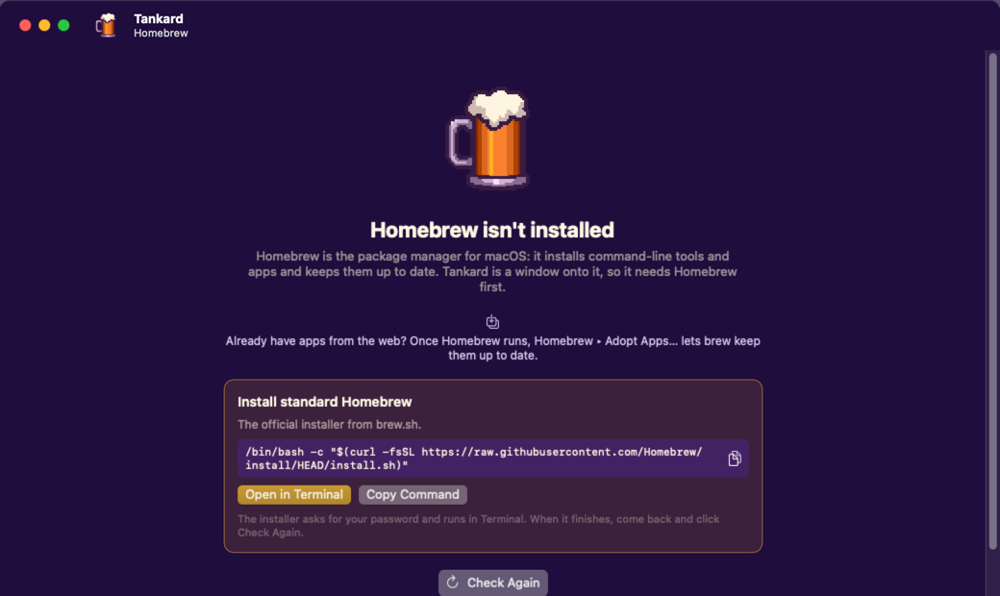
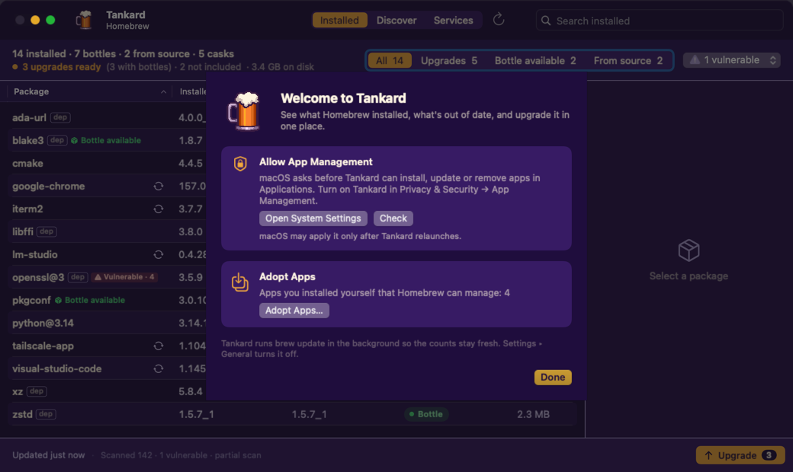
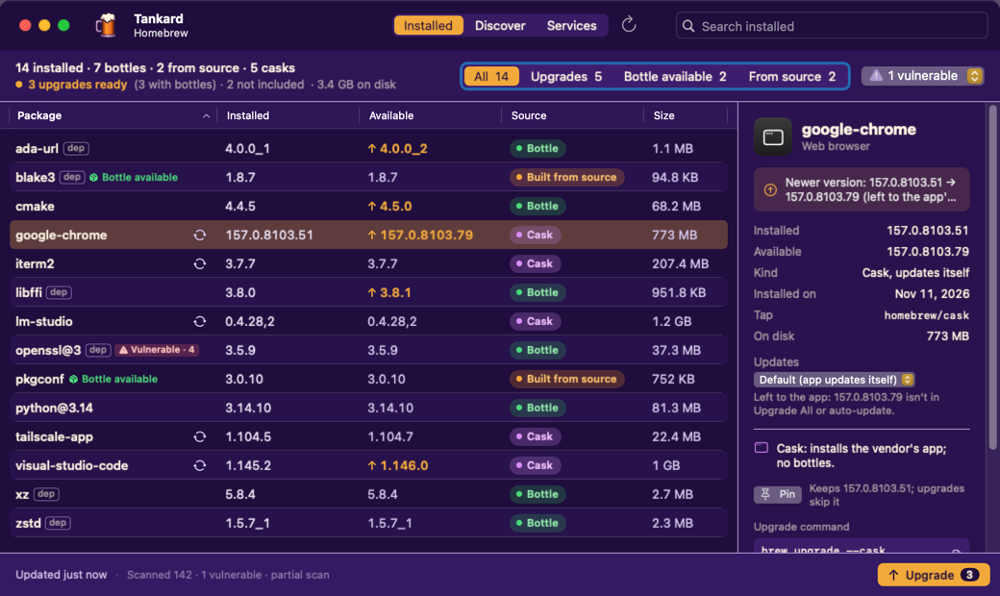
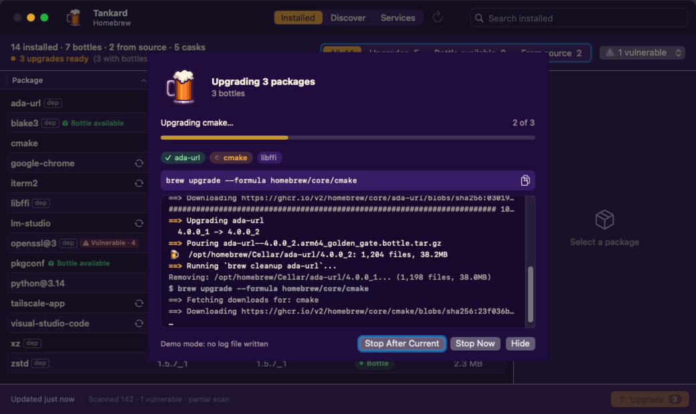
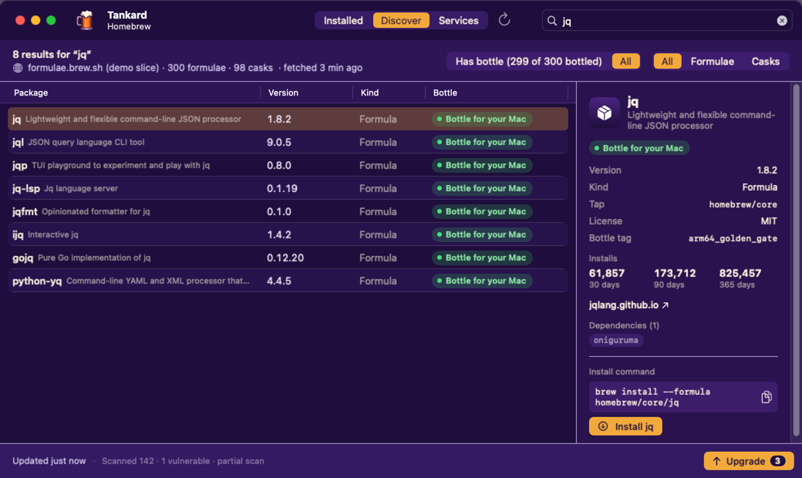
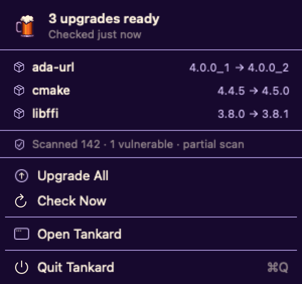
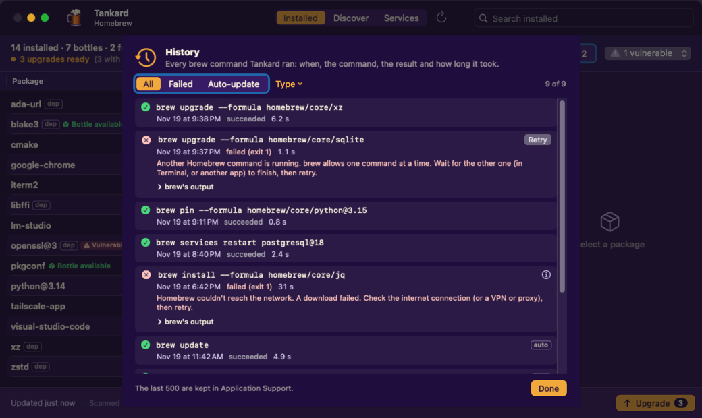

# Tankard Help

Tankard is a Mac app for [Homebrew](https://brew.sh): it shows what you have installed and
what's ready to upgrade, and runs brew for you when you click, showing the exact command
each time. New here? Start with the [Quick start](#quick-start), seven short steps with
pictures. Stuck? The [FAQ and troubleshooting](#faq-and-troubleshooting) answers the
questions people ask most. Everything after that is the full reference, one section per
part of the app. For what Tankard is, see the [README](../README.md); for how it is built,
see [architecture.md](architecture.md). This guide describes Tankard 0.8.9.

## Contents

- [Quick start](#quick-start)
  - [1. Install Tankard (and Homebrew)](#1-install-tankard-and-homebrew)
  - [2. First launch](#2-first-launch)
  - [3. See what's installed](#3-see-whats-installed)
  - [4. Upgrade](#4-upgrade)
  - [5. Install something new](#5-install-something-new)
  - [6. The menu-bar icon](#6-the-menu-bar-icon)
  - [7. Getting help](#7-getting-help)
- [FAQ and troubleshooting](#faq-and-troubleshooting)
- **Reference**
  - [Getting started](#getting-started)
  - [The Installed list at a glance](#the-installed-list-at-a-glance)
  - [Upgrade packages](#upgrade-packages)
  - [Automatic updates](#automatic-updates)
  - [Install from Discover](#install-from-discover)
  - [Uninstall a package](#uninstall-a-package)
  - [Pin a package or skip a version](#pin-a-package-or-skip-a-version)
  - [Adopt apps you installed yourself](#adopt-apps-you-installed-yourself)
  - [Apps that update themselves](#apps-that-update-themselves)
  - [Restore points and rollback](#restore-points-and-rollback)
  - [Vulnerability scan](#vulnerability-scan)
  - [Taps](#taps)
  - [Services](#services)
  - [Health, History, Clean Up and Brewfiles](#health-history-clean-up-and-brewfiles)
  - [The menu-bar icon](#the-menu-bar-icon) and [notifications](#notifications)
  - [Settings reference](#settings-reference)
  - [Menu reference](#menu-reference)
  - [Privacy and network](#privacy-and-network)
  - [What Tankard runs](#what-tankard-runs)
  - [App Management](#app-management)
  - [Troubleshooting](#troubleshooting) (error messages, one by one)
  - [Glossary: Homebrew words explained](#glossary-homebrew-words-explained)

## Quick start

### 1. Install Tankard (and Homebrew)

Install Tankard with Homebrew, or download `Tankard.zip` from
[Releases](https://github.com/d4rkwyng/tankard/releases) and move Tankard.app to
Applications. It needs macOS 14 Sonoma or later, on Intel or Apple silicon.

```sh
brew install --cask d4rkwyng/tap/tankard
```

No Homebrew yet? Open Tankard anyway: it shows the exact command to install Homebrew (on an
Intel Mac, Intelbrew first). Click **Open in Terminal**, type your password when the
installer asks, then come back and click **Check Again**.



More: [Install](#install), [First launch](#first-launch).

### 2. First launch

With Homebrew installed, a **Welcome to Tankard** sheet appears once. Click **Open System
Settings** and turn on Tankard under **Privacy & Security ▸ App Management**, so it can
install, update and remove apps; then click **Check**. If Tankard found apps you installed
yourself that Homebrew can manage, **Adopt Apps…** lists them. Click **Done** to close the
sheet for good.



More: [App Management](#app-management),
[Adopt apps you installed yourself](#adopt-apps-you-installed-yourself).

### 3. See what's installed

The **Installed** tab (⌘1) lists every package: its version, the version available (↑ when
an upgrade is ready), where it came from and its size. Click a package to see its details
on the right, with a button for everything you can do with it. Each button shows the brew
command it runs. **Upgrades** in the filter bar shows only what is out of date; **Edit ▸
Find** (⌘F) jumps to the search field.



More: [The Installed list at a glance](#the-installed-list-at-a-glance).

### 4. Upgrade

Click **Upgrade N** at the bottom right of the window to upgrade everything that's ready, or
select packages (⌘-click to add more) and the same button reads **Upgrade N Selected**. The sheet shows each package, the exact
command and brew's live output; one failure doesn't stop the rest. Anything that would
compile from source is shown in a plan first, so you can skip it. **Hide** keeps the run
going in the background.



More: [Upgrade packages](#upgrade-packages), [Automatic updates](#automatic-updates).

### 5. Install something new

Click **Discover** (⌘2) and search, for example `jq`. Select a package to see its homepage,
license, dependencies and install counts, then click **Install <name>**. Formulae with a
bottle for your Mac (a ready-made download) come first; one that would compile says so on
the button.



More: [Install from Discover](#install-from-discover).

### 6. The menu-bar icon

The mug in the menu bar shows how many upgrades are ready. Click it for the list: click a
package to open it in Tankard, or **Upgrade All** to upgrade everything in a small window
of its own. **Check Now** looks for new versions; **Open Tankard** brings the window back.
With the icon on, closing the window keeps Tankard running.



More: [The menu-bar icon](#the-menu-bar-icon), [Notifications](#notifications).

### 7. Getting help

- **Help ▸ Tankard Help** opens this page; **Help ▸ Homebrew Words Explained** opens the
  [glossary](#glossary-homebrew-words-explained).
- **Homebrew ▸ History…** lists every brew command Tankard ran and what happened, with
  **Retry** for failed ones. **Homebrew ▸ Health…** runs `brew doctor` and explains its
  warnings.
- The [FAQ](#faq-and-troubleshooting) below covers the common questions; **Help ▸ Report an
  Issue…** for anything else.



More: [Health, History, Clean Up and Brewfiles](#health-history-clean-up-and-brewfiles).

## FAQ and troubleshooting

Short answers, each with a link to the full details. Error messages are also listed one by
one under [Troubleshooting](#troubleshooting).

- [Tankard says Homebrew isn't installed](#tankard-says-homebrew-isnt-installed)
- [Why did it ask for my password?](#why-did-it-ask-for-my-password)
- [Why does Homebrew ask me to trust a tap?](#why-does-homebrew-ask-me-to-trust-a-tap)
- [Why is a package "built from source"?](#why-is-a-package-built-from-source)
- [Upgrade All skipped a package](#upgrade-all-skipped-a-package)
- [Tankard says "Another Homebrew command is running"](#tankard-says-another-homebrew-command-is-running)
- [I'm offline, or behind a proxy](#im-offline-or-behind-a-proxy)
- [How do I undo an upgrade?](#how-do-i-undo-an-upgrade)
- [Tankard says "macOS blocked changing an app"](#tankard-says-macos-blocked-changing-an-app)
- [Notifications don't show](#notifications-dont-show)
- ["Tankard can't be opened" (Gatekeeper)](#tankard-cant-be-opened-gatekeeper)
- [Quit asks "Quit anyway?"](#quit-asks-quit-anyway)
- [Tankard vanished from the Dock](#tankard-vanished-from-the-dock)
- [Where are the logs?](#where-are-the-logs)
- [How do I uninstall Tankard cleanly?](#how-do-i-uninstall-tankard-cleanly)

### Tankard says Homebrew isn't installed

Tankard looks for brew only where Homebrew's installer puts it: `/opt/homebrew/bin/brew`
(Apple silicon) and `/usr/local/bin/brew` (Intel, and Intelbrew), this Mac's own one first. A brew somewhere else
isn't used. If the window says brew is there but doesn't run, reinstalling Homebrew usually
fixes it. After installing, click **Check Again**. See
["Homebrew not found"](#homebrew-not-found).

### Why did it ask for my password?

Some casks need your Mac's administrator password: ones that run a `.pkg` installer
(Microsoft Office, Windows App, drivers), and ones whose uninstall removes a background
service, a kernel extension or system files, which an upgrade does too. They show a small
lock, and Upgrade All runs them last. Tankard's dialog passes the password straight to
`sudo`; it isn't kept, logged or saved. **Cancel** stops that step and shows the command to
run in Terminal instead. Formulae never ask, and automatic updates never ask (they skip
those casks). See [Casks that need your password](#upgrade-packages).

### Why does Homebrew ask me to trust a tap?

Homebrew 7 won't load a package from a third-party tap (anything not from Homebrew itself)
until you trust that tap, because its formulae and casks are the author's own code and run
on your Mac. Such a package shows **can't be read** in Installed, and brew won't upgrade
it. **Trust Tap…** in its details (or **Trust…** in **Homebrew ▸ Taps…**) runs
`brew trust` after asking. Trust only taps whose author you trust. See [Taps](#taps).

### Why is a package "built from source"?

There was no bottle (ready-made download) of it for your Mac and macOS version when it was
installed, so brew compiled it, which can take minutes to hours. An orange hammer marks an
upgrade that would compile; tick **Skip packages that would compile** to leave those out.
When a bottle appears later, **Replace with Bottle** swaps it in. On an older Intel Mac,
Intelbrew provides bottles that standard Homebrew no longer builds. See
[Skip compiling](#upgrade-packages) and the [source badges](#the-installed-list-at-a-glance).

### Upgrade All skipped a package

Upgrade All leaves out, on purpose:

- **apps that update themselves** (⟳), unless you turn on **Settings ▸ Upgrades ▸ Include
  self-updating apps** or set that app to **Homebrew updates it**
  ([details](#apps-that-update-themselves));
- **pinned packages** and **skipped versions**
  ([details](#pin-a-package-or-skip-a-version));
- packages that would compile, if you ticked **Skip packages that would compile**.

Automatic updates also skip running apps, casks that need your password and anything that
would compile; the Auto-update log says why for each ([details](#automatic-updates)). If
brew upgraded a package along the way as another one's dependency, History says "upgraded
earlier in this run".

### Tankard says "Another Homebrew command is running"

A brew in Terminal or another app held brew's lock. Tankard waits up to 15 minutes ("Waiting
for another Homebrew command to finish…"), then gives up on that step. Let the other brew
finish, then click **Retry**. "Another Homebrew run was installing it" means the same
package was being installed elsewhere at the same moment: retry once that has finished. See
[Troubleshooting](#another-homebrew-command-is-running).

### I'm offline, or behind a proxy

Offline, Tankard keeps showing the last list it read, and a banner quotes the lines that
failed until the next successful update or **Dismiss**. Scheduled checks wait for the
network and don't fill History with failures. Once you are back online (or fixed the
proxy), click **Refresh** (⌘R); no relaunch needed. For brew's own downloads, set the
lower-case `http_proxy`, `https_proxy` and `no_proxy` in your shell profile or brew.env.
Tankard's own requests use the proxy in **System Settings ▸ Network**. See
[Privacy and network](#privacy-and-network).

### How do I undo an upgrade?

Turn on **Settings ▸ Upgrades ▸ Keep the previous version after upgrades** *before* you
upgrade. Then **Homebrew ▸ Restore Points…**, choose the point from before the upgrade and
click **Restore…**; the plan shows every command first. Only formulae whose old version is
still installed can be rolled back; casks can't. See
[Restore points and rollback](#restore-points-and-rollback).

### Tankard says "macOS blocked changing an app"

Tankard needs App Management permission to install, upgrade or remove apps. Turn it on in
**System Settings ▸ Privacy & Security ▸ App Management**, then click **Relaunch Tankard**:
macOS applies it only to an app started afterwards. Tankard then offers **Run Again**. See
[App Management](#app-management).

### Notifications don't show

**Settings ▸ General ▸ Notify me about new upgrades** is off by default. With it on, check
that Tankard is allowed in **System Settings ▸ Notifications** (Settings shows a warning and
**Open Notification Settings** if it isn't). The first check only records what is already
out of date, and **Refresh** notifies only when the Tankard window isn't in front. See
[Notifications](#notifications).

### "Tankard can't be opened" (Gatekeeper)

Releases are signed and notarized, so this only happens with a build someone else made. On
macOS 15 and later, try to open it, then click **Open Anyway** in **System Settings ▸
Privacy & Security**; on macOS 14, right-click Tankard.app ▸ **Open**. See
["Tankard can't be opened because Apple cannot check it"](#tankard-cant-be-opened-because-apple-cannot-check-it).

### Quit asks "Quit anyway?"

brew is still working. **Keep Running** lets it finish, **Stop After Current and Quit**
finishes the current package first, and **Quit Now** stops brew, which undoes the
unfinished step. Packages that didn't get their turn are offered at the next launch. With
nothing running, Quit closes any open sheet and quits, from the menu, the Dock or a logout.
See [Upgrade packages](#upgrade-packages).

### Tankard vanished from the Dock

With the menu-bar icon on, closing the window keeps Tankard running in the menu bar, and
**Hide Dock icon when the window is closed** (on by default) takes it out of the Dock and
⌘-Tab. Click the mug ▸ **Open Tankard**, or untick the setting. See
[The menu-bar icon](#the-menu-bar-icon).

### Where are the logs?

- **Homebrew ▸ History…**: every brew command Tankard ran (the last 500), with its result.
- `~/Library/Logs/Tankard/upgrade.log`: brew's full output for every run.
- **Settings ▸ Upgrades ▸ Show Auto-update Log…**: the last 20 automatic runs.
- **Homebrew ▸ Health…**: `brew doctor`, `brew config` and your `HOMEBREW_*` settings.

History, restore points and the Auto-update log are kept in
`~/Library/Application Support/net.mindtricks.tankard`. See
[Health, History, Clean Up and Brewfiles](#health-history-clean-up-and-brewfiles).

### How do I uninstall Tankard cleanly?

Quit Tankard, then, if Homebrew installed it:

```sh
brew uninstall --cask --zap d4rkwyng/tap/tankard
```

`--zap` also removes its settings, history, restore points, caches and logs. Without
Homebrew, drag Tankard.app to the Trash and delete these yourself:
`~/Library/Application Support/net.mindtricks.tankard`,
`~/Library/Caches/net.mindtricks.tankard`, `~/Library/Logs/Tankard` and
`~/Library/Preferences/net.mindtricks.tankard.plist`. Removing Tankard doesn't touch
Homebrew or anything it installed.

---

The rest of this page is the full reference.

## Getting started

### Install

```sh
brew trust --tap d4rkwyng/tap      # once: Homebrew 7 asks you to trust a third-party tap
brew install --cask d4rkwyng/tap/tankard
```

Or download `Tankard.zip` from
[Releases](https://github.com/d4rkwyng/tankard/releases), unzip it and move Tankard.app to
Applications. Tankard needs macOS 14 Sonoma or later, on Intel or Apple silicon.

### First launch

- **No Homebrew yet?** The window shows how to install it, with the exact command. On an
  Intel Mac it offers Intelbrew first (Homebrew with prebuilt Intel bottles), then standard
  Homebrew. On Apple silicon it offers standard Homebrew. Click **Open in Terminal**, enter
  your password when the installer asks, then come back and click **Check Again**.
- **Homebrew already installed?** A welcome sheet appears once, over the list:
  - **Allow App Management.** macOS asks before Tankard can install, update or remove
    apps. Click **Open System Settings**, turn on Tankard under Privacy & Security ▸ App
    Management, then click **Check**. If it still says "Not allowed yet", click **Relaunch
    Tankard**. See [App Management](#app-management).
  - **Adopt Apps.** Shown when Tankard finds apps you installed yourself that Homebrew can
    manage. See [Adopt apps you installed yourself](#adopt-apps-you-installed-yourself).
  - Click **Done** to close it for good.

Tankard runs `brew update` in the background so the upgrade counts stay current. It never
installs or upgrades anything on its own unless you turn on
[automatic updates](#automatic-updates). To stop the background update, untick
**Settings ▸ General ▸ Check for new versions in the background**.

Scheduled checks (the background update, the new-upgrades notification check and
automatic updates) don't start while the Mac is asleep or has no network. After the Mac
wakes, Tankard waits for the network, then checks once. A scheduled `brew update` that
takes more than 15 minutes is stopped, and one that is running when the Mac goes to sleep
is stopped too. When a scheduled check can't finish (offline, another Homebrew command
running, sleep, too slow), History shows one gray line, such as "Scheduled check didn't
run: offline. Will retry.", instead of a red failure each time. Refresh and anything else
you start still report every failure in full.

## The Installed list at a glance

- **Toolbar:** Installed, Discover and Services (⌘1, ⌘2, ⌘3), Refresh (⌘R) and search.
  Search matches the name and description. **Edit ▸ Find** (⌘F) puts the cursor in the
  search field of the list on screen, and the down arrow moves from the search field into
  the list. You can paste a whole command such as
  `brew install wget` or `brew install --cask firefox` into either search field: Tankard
  searches for the package name. When nothing installed matches, the list offers **Search Discover for "wget"**,
  which opens Discover with the same search.
- **Keeping current:** the list opens from the last read, then reads brew again when that is
  over an hour old, or as soon as something was installed, upgraded or removed since (in
  Terminal too: Tankard compares the modification times of brew's Cellar, Caskroom and opt
  folders, at launch and whenever the window comes to the front).
- **Filter bar:** the counts, and the filters **All** and **Upgrades**, then **Bottle
  available**, **From source** and **Newer** when anything matches (the one you're on stays
  until you leave it). The **More** menu next to them has **Vulnerable**, **Pinned**,
  **Installed by you** (packages you installed yourself, not ones pulled in as
  dependencies), **Has notes** and **Deprecated**, each with its count; empty ones are
  grayed out. It shows "N vulnerable" when a scan found something.
- **Table:** the package, the installed version, the available version (an ↑ when an
  upgrade is ready), the source badge and the size on disk. Click a column header to sort.
- **Detail pane:** everything about the selected package: versions, where it came from,
  what it depends on and what uses it, notes from brew, and the buttons for what you can
  do with it. Each button shows the exact brew command it runs.
- **Status bar:** when the list was last updated, and the green **Upgrade N** button.

**Source badges:**

| badge | meaning |
|---|---|
| Bottle (green) | Installed from a prebuilt bottle. In Intelbrew mode it says whose: **Intelbrew bottle** or **Homebrew bottle**. |
| Built from source (orange) | Built from source on this Mac. |
| Newer than tap (blue) | Newer than the version the tap has now (**Newer than Intelbrew** in Intelbrew mode). brew never downgrades it. |
| No bottle yet (gray) | There is no bottle for this Mac, so a reinstall or upgrade compiles. |
| Cask (purple) | An app or other cask. |

Other marks: `dep` means it was installed as a dependency. A blue "pinned" tag means
upgrades skip it. ⚠ means it has known vulnerabilities. ⟳ next to a cask means the app
updates itself.

Each package is one line. A note after the name says what matters about it now: an
orange hammer when its upgrade compiles from source, a green box when a bottle could
replace a source build, or a short note such as "Tap has 1.5.7". In a narrow column the
words are cut short; hover over them for all of it.

**Mac Pro (Late 2013) on a newer macOS.** On a Mac Pro 6,1 running macOS 13 or later
through OpenCore Legacy Patcher, apps built with Electron (Visual Studio Code, Slack,
Discord and many more) can draw incorrectly on its AMD FirePro graphics: blank, black or
flickering windows, or garbled text. Tankard marks such installed apps with an orange ⓘ,
and the app's details explain it and show its Chromium version. Tankard only tells you; it
doesn't change the app. It checks for the Electron framework inside each installed cask's
app (`Contents/Frameworks/Electron Framework.framework`) and reads the Chromium version
from it only when you open that app's details. On any other Mac it checks nothing.

## Upgrade packages

**Upgrade everything:** click the green **Upgrade N** in the status bar, or **Upgrade All**
in the menu-bar icon.

**Upgrade some packages:** select one, ⌘-click (or ⇧-click) to add more, and the status
bar's button reads **Upgrade N Selected** (**Upgrade 1 Selected** for one); it upgrades only
those. Rows without an upgrade, and pinned ones, don't count. The detail pane still shows
the last package you clicked. Right-click the selection for **Upgrade N Selected**, or
press ⌘U. Esc clears the selection, and the button goes back to upgrading everything.
Right-click a single package and choose **Upgrade <name>** to upgrade just that one.

The upgrade sheet shows each package, the exact command and brew's live output. Packages
upgrade one at a time; a failure doesn't stop the rest.

When several packages need downloading, one `brew fetch` downloads them all first, in
parallel ("Downloading 4 of 9 · 120.0 of 410.0 MB (29%)"); each upgrade then installs from brew's
cache. A download that fails there is tried again by that package's own upgrade, and
`HOMEBREW_DOWNLOAD_CONCURRENCY=1` makes brew download one at a time.

- **Stop Now** stops brew straight away, for one package or many. brew undoes the step it
  was in the middle of: an install stopped while pouring leaves nothing installed, and a
  stopped upgrade keeps the old version. While brew is changing a package (not while it
  downloads) Tankard asks first. History records the step as stopped.
- **Stop After Current** (several packages) lets the running package finish and skips the
  rest.
- **Retry** (one package) or **Retry Failed (N)** runs the failed steps again, with the
  same checks as the Upgrade and Install buttons; right-click a failed package for
  **Retry <name>**. Under the log, one line says what to do about a failure Tankard
  recognizes (another brew's lock, the network, a full disk, a checksum mismatch, folders
  brew can't write).
- **Quitting** while brew runs asks first: **Keep Running**, **Stop After Current and
  Quit**, or **Quit Now** (stops brew as Stop Now does). brew can't carry on after Tankard
  quits, so an interrupted run's remaining packages are offered at the next launch:
  **Upgrade the Remaining N Packages**. This works the same with a sheet open, and for
  Quit from the Dock, AppleScript or a logout. With nothing running, Quit closes any open
  sheet and quits.
- **Hide** keeps the run going in the background. A button in the status bar brings it
  back.
- The full log is saved to `~/Library/Logs/Tankard/upgrade.log`.
- After an upgrade or install, a **Post-install notes** sheet shows any notes brew printed
  for what changed.
- When upgrading one package makes brew upgrade others along the way (as its dependencies
  or dependents), those count as upgraded by the run, and History says "upgraded earlier in
  this run" for them.

**Skip compiling.** An upgrade with no bottle for your Mac is marked "No bottle: will
compile from source" before anything starts. When any selected upgrade would compile, the
sheet opens on a plan first: tick **Skip packages that would compile** to upgrade only the
bottled ones. The Upgrades filter offers the same thing as a **Skip packages that would
compile** button. In Intelbrew mode the warning also says how long the build took on the
Intelbrew builder; expect longer on an older Mac.

**Long builds.** While a package builds from source, the sheet (and the small progress
window) shows how long it has been building: "Building from source… 4 min so far". brew
doesn't say how long a build will take, so the estimate comes from this Mac: once you have
built the same formula from source before, the line adds "(last time on this Mac: about 15
min)", the middle of the last three builds, rounded.

**Replace a source build with a bottle.** A package you built from source whose version
now has a bottle says **Bottle available** under its name and gets a **Replace with Bottle**
button.
The Bottle available filter has **Replace all**.

When one of those gains a bottle after `brew update` (Refresh, Check Now, a background
check or Auto-update), Tankard says so once: a banner at the top of the window ("A bottle is available
for vim") with **Show**, **Replace with Bottle** and a close button, the same line in the
menu-bar menu, and the status bar's note after a Refresh. With **Notify me about new
upgrades** on, it also posts a notification, under the same rules as new upgrades; a
click opens Installed ▸ Bottle available. Nothing is replaced until you click **Replace
with Bottle**. The same formula and version isn't announced again.

**Casks that need your password.** Some casks run a `.pkg` installer (Windows App,
Microsoft Office, drivers), and brew runs that installer with `sudo`. Before such an
upgrade starts, the sheet says "<name> needs your administrator password" and waits for you
to click **Upgrade**; the uninstall confirmation says the same. When brew's sudo asks,
Tankard shows a password dialog, "Tankard needs your password", with one line for what it
is for ("To upgrade windows-app.") and the brew command under **Details**. Type your Mac's
login password and click **OK**:

- The password goes from the dialog straight to sudo. Tankard doesn't keep it, log it or
  save it anywhere.
- **Cancel** stops that step for good (the dialog doesn't come back for it): the sheet says
  **Install cancelled** (or the same for an upgrade) and shows the command to run in
  Terminal instead.
- While the dialog is up, the sheet says "Waiting for your password in the Tankard dialog"
  and shows the Terminal command. If you don't see the dialog, cancel it (or click
  **Stop Now**) and use Terminal.
- A wrong password brings the dialog back ("Wrong password, try again."); after three
  wrong tries sudo gives up and the sheet shows the Terminal command.
- Each brew command asks at most once: brew clears sudo's remembered password before its
  first sudo, and later sudo steps of the same command don't ask again. Upgrading two such
  casks asks twice.
- These casks show a small lock at the end of their row in Installed and Discover, in the
  upgrade plan and in the running upgrade ("Needs your password to upgrade"). Casks whose
  uninstall removes a background service, package receipts, a kernel extension or system
  files get the lock too, because an upgrade runs the old version's uninstall. Upgrade All
  runs them last, so
  the password dialogs come at the end instead of in the middle of the run (a cask that
  depends on one of them runs after it).
- The dialog closes by itself after 5 minutes, or when you click **Stop Now**.
- When brew finishes a step without the part that needed the password, the sheet says so
  (for example, upgraded, but brew couldn't remove its background service) instead of a
  plain ✓.
- The dialog only ever answers the brew step Tankard started for something that may need
  your password. Run any other way (another program's sudo, Terminal), it refuses before
  showing anything, so it can't be used to ask you for your password on someone else's
  behalf.

Other cask installs, upgrades and uninstalls can ask too, when brew needs sudo to replace
or remove files it doesn't own; formulae never do.

Pinned packages and skipped versions are left out of Upgrade N. See
[Pin a package or skip a version](#pin-a-package-or-skip-a-version).

## Automatic updates

**Turn it on:** **Settings ▸ Upgrades ▸ Upgrade packages automatically**. It is off by
default.

- **Schedule:** every day or every week, at a time you choose (03:00 by default). A time
  missed while the Mac slept or Tankard was closed runs once, at the next chance.
- **When it runs:** only while Tankard is running, on AC power, after 10 minutes without
  keyboard or mouse input, and never while brew is busy. Keep the menu-bar icon on, so
  Tankard keeps running after you close the window.
- **Safe mode, always on:**
  - `brew update` first, then one upgrade per package.
  - Bottles only. A package that would compile, or would make brew rebuild something
    from source, is skipped and stays in the Upgrades list for you to do by hand.
  - Pinned packages are skipped.
  - An app that is running is skipped, never quit.
  - Never a password prompt: a cask whose installer needs your administrator password is
    skipped ("needs your administrator password; upgrade it by hand"), and brew is told
    not to run sudo at all (`HOMEBREW_NO_SUDO=1`), so any other step that would need it
    fails with that reason instead of asking. The Auto-update log has **Upgrade Now** for
    those casks: a normal upgrade, which asks for your password.
  - Tankard doesn't upgrade itself this way. The menu-bar icon says when a new Tankard is
    available.
- **Terminal brew running, or quitting mid-run:** a step that finds brew busy waits for it
  quietly, as manual upgrades do (up to 15 minutes; logged), and is skipped as "Homebrew
  was busy" if it is still busy. Quitting Tankard during a step asks first; nothing is
  offered at the next launch: the interrupted run starts again after it, under the same
  conditions. Quitting during the run's `brew update` or download doesn't ask, and that
  run counts as done. That's harmless, since nothing has changed yet: the next scheduled
  run does the work.
- **Automatically upgrade:** **All versions**, **Minor and patch only** or **Patch only**.
  Versions that can't be compared (dates, letters) upgrade only under All versions.
- **Snooze** pauses automatic updates for 1 day, 1 week, or until you turn them back on.
  It is in Settings and in the menu-bar icon. Manual upgrades still work.
- **Show Auto-update Log…** lists the last 20 runs: what was upgraded, what was skipped
  and why, and what failed. You also get a notification after a run that changed
  something.

## Install from Discover

1. Click **Discover** (⌘2) and search. Formulae with a bottle for your Mac come first.
2. Select a package. The detail pane shows its homepage, license, dependencies, install
   counts for the last 30, 90 and 365 days, and the exact command.
3. Click **Install <name>**.

The sheet shows brew's output and the download's progress, such as "Downloading
font-inter… 25.4 of 33.7 MB (75%)". An install that can't reach the network says so after
30 seconds without progress.

- A formula with no bottle for your Mac says so, and the button reads **Install
  X (compiles)…**. Tankard asks before it starts.
- **Apps (casks) are turned off.** An Intelbrew Mac set up without casks can't install
  apps like Firefox: casks come from the homebrew/cask tap, which the Intelbrew installer
  adds only when you say yes. Discover then shows a banner; **Turn On Apps…** asks, then runs
  `brew tap homebrew/cask` (a one-time download of about 620 MB). The ✕ hides the banner;
  you can add the tap later from **Homebrew ▸ Taps…**.
- The **Has bottle** filter (**Has Intel bottle** in Intelbrew mode) hides formulae that
  would compile. It is on by default in Intelbrew mode.
- A package you already have offers **Show in Installed** instead.
- **Your own taps are searched too.** Besides Homebrew's main catalog, Discover lists the
  formulae and casks of every tap you added (anything outside `homebrew/`, read from the tap
  on this Mac; nothing is sent anywhere). A package from a tap you haven't added can't be
  found: add the tap first (**Homebrew ▸ Taps…**, or **Taps…** on an empty search).

## Uninstall a package

1. Select the package and click **Uninstall <name>…** in the detail pane, or right-click it
   and choose **Uninstall…**.
2. Read the confirmation and click **Uninstall**.

- **Dependencies:** the sheet lists dependencies that nothing else would need afterwards,
  under "No longer needed by anything". **Also remove these** is on by default. Tankard
  checks each one again right before removing it, and keeps it if something now needs it.
  Other unused dependencies on your Mac are left alone; use **Homebrew ▸ Remove Unused
  Dependencies…** for those.
- **Needed by other packages:** uninstall is blocked, and the sheet lists what needs it.
- **Pinned:** the sheet offers **Unpin and Uninstall**.
- **Apps:** uninstalling a cask deletes its app.
- **Several versions of a formula** (after an upgrade with **Keep the previous version**, or
  a rollback): the confirmation says "Removes all installed versions of x (1.0, 1.1)", and
  Tankard runs `brew uninstall` once per version. Afterwards it checks what is still
  installed; anything left shows as "Uninstall incomplete" with the versions.

## Pin a package or skip a version

**Pin:** select the package and click **Pin** in the detail pane, or use the right-click
menu. A pinned package is never upgraded, by Tankard or by `brew upgrade`. **Unpin**
undoes it. The **Pinned** filter (in **More**) lists them.

**Skip one version:** click **Skip Version X** in the detail pane or the right-click
menu. Upgrade N, the menu-bar count and automatic updates
leave that version out. You can still upgrade it by hand, and the next version clears the
skip.

**Dependencies:** the detail pane shows **Depends on** and **Used by**, with a dependency
tree below them. Click a name to jump to that package. The right-click menu has **Show
Dependencies** and **Show What Uses It**.

## Adopt apps you installed yourself

Apps you downloaded yourself can be handed to Homebrew, so `brew upgrade` keeps them up to
date.

1. Choose **Homebrew ▸ Adopt Apps…**. Tankard scans Applications and ~/Applications. The
   scan changes nothing.
2. Tick the apps to adopt. Each match says what matched: **Matched by app ID**, **Matched
   by name and developer**, **Matched by name and website** or **Matched by name only —
   check before adopting**. Only app-ID matches with a single cask are ticked for you.
   When a cask names app IDs and none is your app's (or its developer's), the app isn't
   offered: it is listed under **No cask** as "possibly a different app", with both IDs.
   An app that updates itself can be adopted only on an app-ID match, because brew then
   adopts it without checking. When several casks install the app (Firefox and Firefox
   ESR, Parallels and Parallels 18), Tankard picks the one whose version fits your app
   and says so; check it before ticking.
3. For an app that updates itself, choose who updates it (see
   [Apps that update themselves](#apps-that-update-themselves)).
4. Click **Adopt** and confirm.

The apps are grouped:

- **Ready to adopt.**
- **Needs update first:** Homebrew adopts only the exact version the cask installs. Update
  the app with its own updater, then click **Scan Again**. Or, when the cask's version is
  newer and the app's ID matches, click **Replace with Homebrew's Version…** (see below).
- **Can't adopt:** for example, the cask runs an installer package, or the app isn't where
  the cask puts it.
- **No cask.**

Apple's apps, App Store apps and apps Homebrew already manages aren't listed. That includes
apps a cask installed with an installer package (Microsoft Word, Teams, Windows App):
Tankard knows them from the package's install receipt and the cask's uninstall steps.

**After adopting, Homebrew owns the app.** It stays where it is, but `brew upgrade`
replaces it with the cask's version, and uninstalling the cask deletes the app.

**Replace with Homebrew's Version.** For an app older than the cask, Homebrew can't adopt
it, but it can install the cask's version in its place. Click **Replace with Homebrew's
Version…** on the app's row. The plan shows the app, its version and the cask's (for
example 3.2.6 → 3.2.8), and what happens: your settings and data in ~/Library are not
touched, and from now on Homebrew manages the app. Quit the app first: if it is open,
Tankard says so and waits for you to click **Check Again**; it never quits the app for
you. Then click **Replace**. Tankard runs `brew install --cask --force <cask>` in the
activity sheet, asking for your password as for any cask install. Tankard keeps a copy of
the app while brew runs. A copy that is kept lives in
~/Library/Application Support/net.mindtricks.tankard/replace-backup/. Copies an earlier
version left in ~/Library/Caches are still listed at the next launch; Tankard does not
move or delete them. The copy is deleted only when brew finished, the app is a whole
app (its Info.plist and its program are real files inside the app, not links), and that
app is the cask's version. Otherwise the copy is kept. If brew stopped halfway (for
example after **Stop Now**) and the app is missing or only partly there, what brew left
is moved next to the copy and the copy goes back. If the app is still whole, the copy is
kept and the sheet says where. If the app changed since the scan (it updated itself) or
was opened again while Tankard made the copy, Tankard doesn't start. If another Homebrew
command is running, Tankard does not wait and try again. Homebrew can wait up to 180
seconds on its download lock and then install from its cache, and still report an error.
When the app is then the cask's version, Tankard says it was updated to that version but
Homebrew reported an error, and keeps the copy of the old version. When brew stops
without changing the app, Tankard says Homebrew is busy and keeps the copy. If Tankard
quits while brew is still running, the next launch does not move the copy. It shows one
notice, "Tankard kept a safety copy of <App> from <date>.", with **Show in Finder**. A
`<App>.app.partial` entry in that folder is what Homebrew left behind, not a safety copy:
the notice names it as what Homebrew left of the app, still with **Show in Finder**, and
Tankard never moves or deletes it. **Known issue.** Stop Now while brew is removing the
app can leave brew listing the cask as installed while the old app is back. Scanning
again still treats it as already from Homebrew, so Replace is not offered.
To clear brew's record, first copy the app somewhere safe (or quit it and drag it to
the Desktop), because `brew uninstall --cask --force <token>` deletes the app at the
cask's path as well; then run it and put the app back. When Stop Now has put the old
app back, the result sheet gives that recovery, with the cask's token, and Tankard
does not run it. Tankard never offers this for a version that is
older or the same, or when the cask's version is a plain build number that is not newer
than the app's (2.0 with build 200, against cask 199). A dotted newer version is offered,
including when the app's short version is a plain number (2, and the cask is 2.1) and
when the app's build number is a different sequence. It is also never offered for a cask
that installs more than the one app (a second app, a command-line tool, a font), or for
a match on the name alone.

Adopt Apps isn't available in Intelbrew mode, because it needs Homebrew's online cask list.

## Apps that update themselves

Many apps (casks) update themselves. They show ⟳ at the end of their row, before the lock
and the ⓘ when those show too. Homebrew 7 lists one as outdated by itself whenever the app
on disk is older than the cask (its own updater fell behind), so `brew upgrade` in Terminal
replaces it. Tankard, by default, leaves them to their own updater: they still show their
newer version, but Upgrade All, the counts, notifications and automatic updates leave them
out. Select one and click **Upgrade 1 Selected** to upgrade it anyway.

- **For all apps:** turn on **Settings ▸ Upgrades ▸ Include self-updating apps** to count
  and upgrade them like any other package (and also list the ones only
  `brew outdated --greedy` reports).
- **For one app:** select it and use the **Updates** menu in the detail pane:
  - **Default**: follows the setting above. The menu says which way it goes now.
  - **App updates itself**: Tankard leaves its upgrades out. `brew upgrade` in Terminal
    can still upgrade it.
  - **Homebrew updates it**: every newer version is listed and upgraded.

**Running apps.** By default brew quits a running app before upgrading it, and reopens it
afterwards. To keep apps open, turn on **Settings ▸ Upgrades ▸ Don't quit running apps
during upgrades**.

## Restore points and rollback

Tankard saves a restore point (the versions you have installed) before every upgrade and
automatic update. It keeps the last 20.

**See or use them:** **Homebrew ▸ Restore Points…**. Each one shows what changed since it
was saved. **Save Now** saves one by hand. **Copy Brewfile** copies its taps, formulae and
casks as a Brewfile.

**Roll back an upgrade:**

1. Turn on **Settings ▸ Upgrades ▸ Keep the previous version after upgrades** before you
   upgrade. The old versions use disk space. Clean Up leaves them alone while the setting
   is on; turn it off first if you want Clean Up to remove them.
2. In Restore Points, choose a point and click **Restore…**. The plan shows every brew
   command first.
3. Leave **Pin rolled-back formulae** on, so the next upgrade doesn't undo it.

While **Keep the previous version after upgrades** is off, Restore Points says so at the
top, with **Keep Old Versions** to turn it on. An upgrade whose old version is gone says
"Old version removed by cleanup".

Only formulae whose old version is still installed can be rolled back. Casks, keg-only and
pinned formulae, HEAD builds and formulae other packages depend on can't. Tankard marks
those and shows the commands to do it by hand. A restore never uninstalls what was added
since.

## Vulnerability scan

Tankard can run `brew vulns` (Homebrew 7) to check your formulae against known
vulnerabilities on OSV.dev.

**Scan:** choose **Homebrew ▸ Scan for Vulnerabilities**, or **Scan Now** in the Vulnerable
filter or in **Settings ▸ Upgrades**. To scan after every refresh, turn on **Scan for
vulnerabilities when refreshing**. It is off by default, because brew sends your formula
names and versions to OSV.dev.

- A vulnerable formula gets a ⚠ tag with its severity. The detail pane lists each advisory,
  linked to OSV.dev, with the version that fixes it, if there is one.
- The **Vulnerable** filter lists them, with **Upgrade N** for those that have an upgrade.
  Pinned packages are left out.
- brew often reports a **partial scan**: it skips formulae it can't match to a source. Those
  say "Not checked by brew vulns". Casks aren't scanned.
- A scan stops after 60 seconds. **Stop** ends it sooner.
- **Show new vulnerabilities in the menu bar** adds a ⚠ to the menu-bar icon and a line in
  its menu when a scan finds something new.

## Taps

A tap is a source of formulae and casks. **Homebrew ▸ Taps…** lists yours, with how many
packages you installed from each.

- **Show Installed** filters the Installed list to one tap.
- **Add Tap…** takes `user/repo`, and optionally a git URL. Third-party taps run their
  authors' code; Tankard warns you first.
- **Remove…** runs `brew untap`. It is blocked while anything installed comes from the tap,
  including packages Homebrew can't read (below), which brew's own check would miss.
- **Packages Homebrew can't read.** brew refuses to load a formula from a tap you don't
  trust, or one its tap has renamed, and then leaves it out of everything it lists for
  Tankard. Tankard finds it in the Cellar or Caskroom instead and shows it in Installed
  with **can't be read**, brew's own reason in its details, and a line in Health. The tap's
  row counts it. brew won't upgrade it until you trust the tap or install it again under its
  new name.
- **Trust…** and **Stop Trusting…** set Homebrew 7's trust for a third-party tap.

## Services

The **Services** tab (⌘3) lists `brew services`. Select one to see its details.

- **Start** starts it and registers it to start at login. **Stop** stops it and unregisters
  it. **Restart** restarts it.
- Services that run as root (started with `sudo`) get no buttons. Tankard shows the `sudo`
  command to run in Terminal instead.

## Health, History, Clean Up and Brewfiles

- **Homebrew ▸ Health…** runs `brew doctor`, `brew config` and `brew missing`. Known
  warnings are explained in plain English, with the command that fixes them. Tankard shows
  the command; it never runs it. **Environment** lists your `HOMEBREW_*` settings, proxy
  variables and `XDG_CONFIG_HOME`: where each comes from, whether Tankard's brew gets it,
  and why not when it doesn't. A proxy's user name and password show as `•••`
  (`http://•••@proxy:8080`), here and in the `brew config` output. A brew.env setting that
  overrides one of Tankard's gets a warning sign and the reason, and the section opens by
  itself. See [Your HOMEBREW_* settings](#my-homebrew_-settings-from-zshrc).
- **Homebrew ▸ History…** lists every brew command Tankard ran (the last 500), with its
  result. Failed ones have **Retry**.
- **Homebrew ▸ Clean Up…** shows what `brew cleanup` would remove and how much space it
  frees, then runs it when you click **Clean Up**. While **Keep the previous version after
  upgrades** is on, it leaves those old versions alone (it runs with
  `HOMEBREW_NO_CLEANUP_FORMULAE` set to those formulae, shown in the command). Old versions
  it would remove are listed under "Removes old versions you could roll back to", and then
  Return doesn't run it: click **Clean Up**.
- **Homebrew ▸ Remove Unused Dependencies…** shows what `brew autoremove` would remove
  before it runs.
- **File ▸ Export Brewfile…** saves a Brewfile of your taps, formulae and casks.
- **File ▸ Check Brewfile…** first shows what the Brewfile lists, read from the file's
  text: its plain `tap`, `brew`, `cask`, `mas` and `vscode` lines. Nothing in it has run
  yet. Lines it can't read that way are listed as "Not read: needs brew to evaluate". A
  Brewfile is a Ruby program, and `brew bundle check` runs the code in it, so **Check with
  brew…** asks first ("Run this Brewfile's code?"), with a stronger warning for a file
  downloaded from the internet. Continue only if you trust whoever wrote the file. Tankard
  reads the file again right before brew runs it, and refuses if it changed since the
  preview (check it again to see the new text); it reads only an ordinary file of at most
  1 MB, never a pipe, a device, a folder or a symbolic link, and brew runs a private copy
  of exactly what Tankard read. Because of that copy, a file the Brewfile loads by a path
  relative to itself (`require_relative`, `__dir__`) isn't found; Tankard warns when the
  Brewfile loads other files. The check then lists what the Brewfile needs that this Mac doesn't have. **Restore Plan…**
  installs them one by one with **Install with Tankard**, or gives you the `brew bundle`
  command to copy.

Deprecated and disabled packages get a tag and a box in the detail pane with Homebrew's
reason and suggested replacement.

## The menu-bar icon

A mug in the menu bar with the number of upgrades ready. Click it for:

- the upgrades (up to 8; "and N more…" opens the list);
- the scan's progress or the last scan's result, a new-vulnerabilities notice, the last
  automatic update, and **Snooze**, when they apply;
- **Upgrade All** and **Check Now** (the same as Refresh), then **Open Tankard**, then
  **Quit Tankard**.

The panel closes after Open Tankard, Check Now or a click on a package. Click an upgrade to
open Tankard on it: the Installed tab's Upgrades list, with the search cleared and the
package selected, so the status bar's button reads **Upgrade 1 Selected** and its details
show its upgrade command and any compile warning. A long new
version is always shown whole; the old one is shortened in the middle instead. Click "N upgrades ready" for the Upgrades list, or the finished scan's line
("Scanned 11 · found 2") for the Vulnerable list. **Upgrade All** is the only thing the menu
runs itself.

**Upgrade All** (and **Upgrade** in a row's right-click menu) closes the menu and shows the
upgrade in a small window of its own, not the whole Tankard window: the packages, progress,
brew's output, the compile plan when something builds from source, and **Stop**. A password
dialog for a cask appears above it.

- **Show in Tankard** opens the Tankard window with the same run in its sheet.
- When everything upgraded, the window closes by itself after a moment, with a "Tankard
  upgraded N packages" notification (click it for History). If brew printed post-install
  notes, the window shows them instead and stays until you click **Done**.
- When something failed or you stopped it, the window stays open with what went wrong,
  **Retry** where it applies, and **Close**.
- Closing it while brew runs only hides it: the run goes on. The first time in a session
  Tankard says so and asks before closing. The menu's line then reads **Show Upgrade
  Progress** while brew runs, **Show Upgrade Results** once it has finished, and **Show
  Upgrade Plan** when a compile plan is waiting. It always brings the window to the front,
  even when other windows cover it.
- A hidden run that finishes posts a notification: "Tankard upgraded N packages" when all
  went well (the menu goes back to **Upgrade All**), or "The upgrade finished with
  problems" (or with notes to read), which opens the results.
- These notifications follow macOS's notification setting for Tankard (System Settings ▸
  Notifications), not Tankard's "new upgrades" setting: you started the run. With
  notifications off for Tankard, nothing is shown and everything else works the same.
- With the Tankard window already in front (Tankard active, you were last in its window,
  and the window not covered or on another Space), Upgrade All opens the usual sheet on it.
- The window is titled for what it shows ("Upgrading 3 packages", "Upgrade finished", "Upgrade
  finished with problems") and takes each page's size; a page taller than the screen scrolls.
- A menu-bar Upgrade while a plan or another sheet is up shows that first and starts nothing.
- The window opens in the middle of the screen you're on, then where you last left it
  until Tankard quits. It opens on the Space you are on, also over a full-screen app.
- While the window shows a run, its results or a plan, the Tankard window's own Upgrade,
  Uninstall, Install and Replace buttons wait, as they did behind the sheet; their help
  says why. The button at the bottom right of the Tankard window moves the run (or plan)
  into the window instead.

The Homebrew and File menus wait while this window is open, as they do for a sheet.

With the icon on, closing the window keeps Tankard running. With **Hide Dock icon when the
window is closed** on (the default), Tankard then also leaves the Dock and ⌘-Tab. Click
**Open Tankard** to bring the window back.

### Notifications

**Turn them on:** **Settings ▸ General ▸ Notify me about new upgrades**. It is off by
default. macOS asks for permission the first time.

- Tankard runs `brew update` in the background every check interval, and posts a
  notification when upgrades appear that weren't there at the last check. The first check
  only records what is already outdated.
- **Refresh** (⌘R) and **Check Now** post a notification only when the Tankard window isn't
  in front. With the window in front, the status bar shows the result for a few seconds,
  such as "3 new upgrades" or "No new upgrades". Upgrades seen this way aren't announced
  again.
- With the setting off, the first Refresh that finds new upgrades adds a one-time hint:
  "Turn on notifications in Settings ▸ General".
- If notifications for Tankard are off in **System Settings ▸ Notifications**, the toggle
  stays off, or shows a warning, with an **Open Notification Settings** button.
- **Click a notification** to open Tankard on **Installed ▸ Upgrades**. Its **Upgrade All…**
  action opens a sheet listing what would be upgraded; nothing runs until you click
  **Upgrade N** there. **Later** just dismisses it. Clicking an automatic-update
  notification opens the Auto-update log.

**Show new vulnerabilities in the menu bar** (Settings ▸ Upgrades) is not a notification.
It adds a ⚠ next to the menu-bar icon and a line in its menu. A scan never posts a
notification.

## Settings reference

Open with **Tankard ▸ Settings…** (⌘,). Each setting has an ⓘ button with more detail.

**General**

| setting | default | what it does |
|---|---|---|
| Show Tankard in the menu bar | on | The mug icon. With it on, closing the window keeps Tankard running. |
| Show the number of upgrades in the menu bar | on | Off: only the mug (full when upgrades are ready); the number stays in its tooltip and the menu. |
| Hide Dock icon when the window is closed | on | Only with the menu-bar icon on. |
| Check for new versions in the background | on | Runs `brew update` at most once per check interval. Grayed out when `HOMEBREW_NO_AUTO_UPDATE` is set; Settings says where. |
| Notify me about new upgrades | off | A notification when new upgrades appear. See [Notifications](#notifications). |
| Check every | 6 hours | 1, 3, 6, 12, 24 or 48 hours. Used by the two settings above. |
| Open Tankard at login | off | Adds Tankard to Login Items. |

**Upgrades**

| setting | default | what it does |
|---|---|---|
| Include self-updating apps | off | Counts and upgrades apps that update themselves. Off, Tankard leaves them to their own updater. |
| Don't quit running apps during upgrades | off | brew upgrades a running app without quitting it. |
| Keep the previous version after upgrades | off | Needed for rollback. Uses disk space. |
| Upgrade packages automatically | off | Schedule, version rule and Snooze. See [Automatic updates](#automatic-updates). |
| Automatically upgrade | All versions | Or Minor and patch only, or Patch only. |
| Scan for vulnerabilities when refreshing | off | Sends formula names and versions to OSV.dev. |
| Show new vulnerabilities in the menu bar | off | A notice in the menu-bar icon. |

**Technical details.** The settings' ⓘ notes are in plain words; this is what they do underneath:

- **Check for new versions in the background** runs `brew update` at most once per check interval, waits while
  brew is busy, and only logs a failure (offline). It is off, and grayed out, when `HOMEBREW_NO_AUTO_UPDATE` is
  set in your shell profile or brew.env; Settings says which file.
- **Notify me about new upgrades** uses the same background `brew update`. Refresh and Check Now post a
  notification only when the Tankard window isn't in front.
- **Include self-updating apps** lists casks with `auto_updates` or `version :latest`, as
  `brew outdated --greedy` does. Off, the `auto_updates` casks brew lists by itself (its
  default `HOMEBREW_UPGRADE_AUTO_UPDATES_CASKS`, when the app bundle is older than the cask)
  stay visible but out of Upgrade All, the counts and automatic updates.
- **Don't quit running apps during upgrades** sets `HOMEBREW_NO_UPGRADE_QUIT_CASKS=1` for cask upgrades (it shows
  in the command under **Details**). Without it, brew quits a running app before upgrading its cask and opens it
  again afterwards, and Tankard's upgrade plan names the open apps before it starts.
- **Keep the previous version after upgrades** runs Tankard's upgrades, installs and reinstalls (manual and
  automatic) with `HOMEBREW_NO_INSTALL_CLEANUP=1`. brew's own periodic cleanup, run by brew outside Tankard, can
  still remove old versions.
- **Scan for vulnerabilities when refreshing** runs `brew vulns`; a scan that runs longer than a minute is
  stopped. Casks aren't checked.
- A brew.env `SUDO_ASKPASS` that points to another program, or one that clears `HOMEBREW_NO_SUDO`, makes Tankard
  leave password steps to Terminal ("Your Homebrew settings use a different password program").

**Appearance:** **Dark**, **Light**, **System** (the default, follows your Mac), **Tankard**
(purple and amber) and **Dracula**.

**Language:** Tankard follows the macOS language: English, German, French, Spanish,
Italian, Portuguese (Brazil), Japanese, Korean or Simplified Chinese. The translations are
machine translations; corrections are welcome.

## Menu reference

- **Tankard:** About Tankard, **Check for Tankard Updates…**, Settings… (⌘,), Quit Tankard (⌘Q).
- **File:** **Check Brewfile…**, **Export Brewfile…**, Close (⌘W), Close All.
- **Edit:** the usual editing commands, and **Find** (⌘F): the search field of the list on
  screen (Installed, Discover or Services).
- **View:** **Installed** (⌘1), **Discover** (⌘2), **Services** (⌘3).
- **Homebrew:**
  - **Refresh** (⌘R), **Upgrade All…** (⇧⌘U, shows the plan first), **Upgrade <name>** (⌘U,
    the package selected in Installed, or **Upgrade N Selected** for several; **Upgrade
    Package**, grayed out, when none is),
    **Scan for Vulnerabilities**
  - **Health…**, **History…**
  - **Clean Up…**, **Remove Unused Dependencies…**
  - **Taps…**, **Adopt Apps…**, **Restore Points…**
  - **Revert to Standard Homebrew…** (Intelbrew mode only), **Uninstall Homebrew…**
- **Help:** **Tankard Help** (this page), **Homebrew Words Explained** (the
  [glossary](#glossary-homebrew-words-explained)), **Tankard on GitHub**, **Report an
  Issue…**

Items that run brew or open a sheet gray out while brew is busy (a run shown or hidden)
and while a sheet is open. **History…** and **Check for Tankard Updates…** stay available
during a hidden run.

**Tankard ▸ Check for Tankard Updates…** asks GitHub for the latest release, only when you
choose it. If Homebrew installed Tankard, **Upgrade with Homebrew** upgrades it and offers
to relaunch. Otherwise **Download** opens the release page.

**Revert to Standard Homebrew…** and **Uninstall Homebrew…** never run inside Tankard. Each
shows exactly what will run and asks you to type a word (`revert` or `uninstall`). Then it
opens Terminal with the commands, and waits for you to press Return.

- **Revert** switches an Intelbrew Mac back to standard Homebrew. It backs up your shell
  startup files, removes the Intelbrew lines from them, points brew back at
  Homebrew/brew and runs `brew update`.
- **Uninstall Homebrew** runs Homebrew's official uninstaller with `--path` set to the
  prefix Tankard shows, so on a Mac with both /usr/local and /opt/homebrew only that one is
  removed. It removes every package installed there.

**Right-click menus** on the Installed list, Discover and the menu-bar list offer the same
actions as the buttons, plus Copy Name, Copy Upgrade (or Install) Command, Open Homepage,
Open Release Page and Show in Finder.

## Privacy and network

<a id="how-it-behaves"></a>

Tankard has no telemetry and no account. Its own network requests:

- **Discover** (normal mode) downloads Homebrew's catalog from formulae.brew.sh the first
  time you open it, and keeps it for an hour. It also downloads Homebrew's public install
  counts (about 13 MB, for every package), and keeps them for a day. Because these are the
  files for every package, the site never learns which packages you look at. Adopt Apps uses
  the same catalog.
- **Download progress for a cask:** one request to the cask's own download server for the
  file size.
- **Check for Tankard Updates…:** one request to GitHub, only when you choose it.
- **Intelbrew mode:** Discover reads your local taps instead of formulae.brew.sh. When a
  compile warning is shown, Tankard downloads Intelbrew's build times from GitHub.

brew's own requests:

- `brew update` (Refresh, Check Now and the background update) fetches from GitHub and
  formulae.brew.sh, as it does in Terminal.
- `brew vulns` sends each formula's source repository and version to OSV.dev. It runs only
  when you scan, or on every refresh if you turn that on.
- Installing, upgrading and adopting download from where brew always does.
- **Analytics:** set `HOMEBREW_NO_ANALYTICS=1` in your shell profile or brew.env and the
  brew Tankard runs sends no Homebrew analytics, the same as in Terminal.
- **Mirrors:** `HOMEBREW_API_DOMAIN`, `HOMEBREW_BOTTLE_DOMAIN` and `HOMEBREW_ARTIFACT_DOMAIN`
  set in a shell profile are not applied by Tankard yet, and Discover still reads
  formulae.brew.sh. Set them in a brew.env file and brew uses them; Tankard's own catalog
  downloads don't.
- **Proxies:** `http_proxy`, `https_proxy`, `all_proxy`, `no_proxy` (and `ftp_proxy`, and
  the upper-case `HTTPS_PROXY`, `ALL_PROXY`, `FTP_PROXY`) set in your shell profile or in
  Tankard's own environment are passed to brew, so brew's downloads, `brew update` and git
  go through your proxy as they do in Terminal. brew itself ignores the upper-case
  `HTTP_PROXY` and `NO_PROXY`, so Tankard doesn't pass them either; use the lower-case
  names. A brew.env file can set the lower-case ones too.
- **Tankard's own requests** (Discover's catalog and install counts, cask download sizes,
  Check for Tankard Updates…) use the proxy in **System Settings ▸ Network ▸ Details… ▸
  Proxies**, like other Mac apps, not the shell variables above.

Links (homepages, release pages) open only when you click them.


**Test switches.** The `TANKARD_*` environment variables that Tankard's own tests and
screenshots use (for example `TANKARD_BREW`, another program to run as brew) are ignored by
the released, Developer ID signed app: it removes them at launch and runs brew only from
`/opt/homebrew` or `/usr/local`. Only builds made from source honour them. The separate
`tankard` command-line tool, built from source and not part of the app, still reads
`TANKARD_BREW` as the default for its `--brew` option; it runs with your own permissions
only.

## What Tankard runs

Reading your packages never changes anything. Your packages change only when you click,
or when automatic updates is on. Commands run one at a time and never through a shell. Tankard never runs sudo
itself; when a cask's installer needs your administrator password, a Tankard dialog passes
it straight to sudo (or you can run the command in Terminal). See below.

| you click | Tankard runs |
|---|---|
| Refresh (⌘R) or Check Now | `brew update` |
| Upgrade | `brew upgrade --formula\|--cask <tap>/<name>`, one per package; first, for two or more bottled formulae or two or more casks, one `brew fetch --formula\|--cask <tap>/<name>...` per kind |
| Install | `brew install --formula\|--cask <tap>/<name>`; installing a Brewfile's missing packages fetches first, as Upgrade does |
| Uninstall | `HOMEBREW_NO_AUTOREMOVE=1 brew uninstall --formula\|--cask <tap>/<name>` (once per installed version of a formula), then each dependency you chose to remove |
| Adopt | `brew install --cask --adopt <tap>/<name>`, one per app |
| Replace with Homebrew's Version | `brew install --cask --force <tap>/<name>` |
| Replace with Bottle | `brew reinstall --force-bottle --formula <tap>/<name>` |
| Pin / Unpin | `brew pin\|unpin --formula\|--cask <tap>/<name>` |
| Clean Up | `brew cleanup` |
| Remove Unused Dependencies | `brew autoremove` |
| Start / Stop / Restart a service | `brew services start\|stop\|restart -- <name>` |
| Add / Remove a tap | `brew tap <user/repo>` / `brew untap <user/repo>` |

The background `brew update` updates Homebrew and its package lists. It doesn't install or
upgrade any of your packages.

With **Don't quit running apps during upgrades** on, cask upgrades start with
`HOMEBREW_NO_UPGRADE_QUIT_CASKS=1`. With **Keep the previous version after upgrades** on,
upgrades and installs start with `HOMEBREW_NO_INSTALL_CLEANUP=1`. The command shown in the
app always includes these.

Cask installs, upgrades, reinstalls, adopts and uninstalls (and a restore's cask steps) also
start with `SUDO_ASKPASS` set to Tankard's password dialog,
`Tankard.app/Contents/Helpers/TankardPassword.app/Contents/MacOS/tankard-askpass` (an app of
its own that never shows in the Dock), and `HOMEBREW_TANKARD_ASKPASS_CONTEXT` set to
the command, which the dialog names in one line ("To upgrade windows-app.") and shows in full
under Details. Homebrew then runs `sudo -A`, which asks the dialog instead
of a terminal. These two are left out of the command shown, because the copy you paste into
Terminal should ask in Terminal; the sheet's log says when a password may be asked for.
Formulae, `brew update`, cleanup, taps, services and every status read never get them.
Automatic updates get `HOMEBREW_NO_SUDO=1` instead.

Upgrades, installs, uninstalls and Replace with Bottle run with
`HOMEBREW_NO_AUTO_UPDATE=1`, so brew installs exactly the versions the list showed;
Refresh is where `brew update` runs. Every brew command also gets the `HOMEBREW_*`
settings Tankard passes on from your shell profile, such as `HOMEBREW_NO_ANALYTICS` and
`HOMEBREW_DOWNLOAD_CONCURRENCY` (see
[My `HOMEBREW_*` settings](#my-homebrew_-settings-from-zshrc)).

## App Management

macOS asks before one app installs, updates or deletes another. Tankard needs this
permission (**System Settings ▸ Privacy & Security ▸ App Management**) for anything that
changes an app: installing, upgrading, adopting or uninstalling a cask that has an app, a
restore point's cask reinstall, and automatic updates. Formulae, fonts and Replace with
Bottle don't need it.

**Allow it:**

1. Before the first app change, Tankard shows a sheet. Click **Open System Settings** and
   turn on Tankard under App Management.
2. Click **I've done this**, then **Relaunch Tankard**. macOS applies the permission only
   to an app started after you allowed it.
3. After the relaunch, Tankard offers **Run Again** for what you were doing. Nothing runs
   until you click it.

**Continue without relaunching** tries straight away instead. On the first sheet,
**Cancel** runs nothing, **Skip Apps, Upgrade N Others** runs only the packages that don't
change apps, and **Continue Without It** runs everything without the permission (macOS may
then stop the app steps).

When macOS blocks a change, the step fails with **"macOS blocked changing an app"**, and
Tankard offers the relaunch again. For automatic updates, you get a notification instead.

The permission is tied to the app's signature. Releases keep it across updates. A build
you made yourself needs it again after every rebuild.

## Troubleshooting

### "macOS blocked changing an app"

Tankard doesn't have App Management permission yet, or macOS hasn't applied it. See
[App Management](#app-management).

### "Waiting for another Homebrew command to finish…"

A brew in Terminal (or another app) holds brew's lock on what this step needs. Tankard
waits for it to finish and then runs the step again, by itself; the rest of the run
waits too. **Stop Now** ends the wait.

### "Another Homebrew command is running"

The other brew kept its lock for 15 minutes, so Tankard gave up on that step. Wait for
it to finish, then **Retry** in the sheet (or **Homebrew ▸ History…**).

### "Another Homebrew run was installing it"

brew stopped with "Bottle destination already exists": another Homebrew run (in Terminal,
or another app) was probably installing the same package at the same moment. Retry once it
has finished.

### "A download didn't match its checksum"

The file brew downloaded isn't the one it expected: often an interrupted download, or a
package that changed upstream since brew last updated. Click **Refresh** (it runs
`brew update`), then **Retry**.

### "Waiting for brew update to finish…"

The background `brew update` is running. Your upgrade, install or uninstall starts as
soon as it is done.

### brew needs a password

For a cask, Tankard shows its password dialog when brew's sudo asks (see
[Casks that need your password](#upgrade-packages)). If you cancel it, type the wrong
password three times, or the step isn't a cask change (a `brew update` that needs sudo,
a service that runs as root), the sheet shows the command to run in Terminal instead.
Automatic updates never ask; they list the cask as skipped.

If the dialog doesn't appear, check the sheet's log for "sudo: a terminal is required":
that means this copy of Tankard has no `tankard-askpass` next to it (a build run with
`swift run`), so use the Terminal command.

### A download failed, or "Homebrew couldn't reach the network"

Check your internet connection, VPN or proxy, then retry. Tankard keeps showing the last
list it read. A failed Refresh shows a banner with the lines brew printed about the failure;
it stays (also after a relaunch) until the next update succeeds or you click **Dismiss**.
Tankard reads brew's settings again on each Refresh, so after fixing the network or a proxy
setting, **Refresh** works without a relaunch.

### "Homebrew not found"

Tankard looks for brew at `/usr/local/bin/brew` and `/opt/homebrew/bin/brew`, where Homebrew's
installer puts it; a brew anywhere else isn't used. Install Homebrew from the welcome screen,
then click **Check Again**.

### My `HOMEBREW_*` settings from `~/.zshrc`

Apps started from the Dock don't run your shell profile, so Tankard reads it (single
`export HOMEBREW_X=value` lines; values that need shell expansion are skipped) and passes
privacy and behavior settings on to brew: `HOMEBREW_NO_ANALYTICS`,
`HOMEBREW_NO_INSECURE_REDIRECT`, `HOMEBREW_CURL_RETRIES`, `HOMEBREW_FORCE_BREWED_CURL`,
`HOMEBREW_TEMP`, the `HOMEBREW_FORBIDDEN_*` lists, cleanup and download settings and a few
more. From `HOMEBREW_CASK_OPTS` only `--require-sha` and `--language=…` pass: `--appdir`
and the other `--*dir` options would move where apps go, which Adopt Apps and the App
Management check rely on, and options like `--force` would act on apps without asking.
**Homebrew ▸ Health… ▸ Environment** shows each one and what happened to it.

Not passed from a shell profile:

- anything that changes where brew lives or what it trusts: `HOMEBREW_PREFIX`, the
  `*_GIT_REMOTE`s, `HOMEBREW_DEVELOPER`, `HOMEBREW_NO_INSTALL_FROM_API`,
  `HOMEBREW_NO_VERIFY_ATTESTATIONS` and the like (Intelbrew mode sets its own remotes);
- `HOMEBREW_CACHE` and `HOMEBREW_LOGS` (download progress and Clean Up assume the default
  folders);
- mirrors (`*_DOMAIN`), tokens, and `HOMEBREW_NO_INSTALLED_DEPENDENTS_CHECK`;
- settings Tankard controls: color, verbose and debug output, and the greedy-upgrade
  switches (Tankard's self-updating apps setting decides those);
- any `HOMEBREW_*` name not on Tankard's list.

To use one of those anyway, put it in a `brew.env` file, such as `~/.homebrew/brew.env`.
brew reads that itself however it is started, and a brew.env value wins over anything
Tankard passes. So a `HOMEBREW_CASK_OPTS` with `--appdir` there applies to Tankard's
installs too; Health ▸ Environment warns about it, because Adopt Apps' location checks
assume `/Applications`. A brew.env that sets `HOMEBREW_NO_INSTALLED_DEPENDENTS_CHECK`
pauses automatic updates (their safe mode relies on that check); Settings and the menu bar
say so. Manual upgrades still run.

Health ▸ Environment warns about every brew.env setting that undoes one of Tankard's:

- `HOMEBREW_UPGRADE_GREEDY`, `HOMEBREW_UPGRADE_GREEDY_CASKS` or
  `HOMEBREW_NO_UPGRADE_AUTO_UPDATES_CASKS`: they override the self-updating apps setting;
- in Intelbrew mode, a `HOMEBREW_CORE_GIT_REMOTE` or `HOMEBREW_BREW_GIT_REMOTE` that isn't
  the fork, or an empty `HOMEBREW_NO_INSTALL_FROM_API`;
- `HOMEBREW_NO_AUTOREMOVE` set to `0` (or empty, `false`, `no`, `off`): Uninstall would
  also remove every other unused dependency, not just what it lists;
- `HOMEBREW_COLOR`, `HOMEBREW_VERBOSE`, `HOMEBREW_DEBUG`, or an empty `HOMEBREW_NO_COLOR`:
  they change brew's output, which Tankard reads;
- `SUDO_ASKPASS` set to anything but Tankard's own helper: brew would send the password
  prompt to that program. Tankard then never offers its password dialog: a cask step runs
  with `HOMEBREW_NO_SUDO=1` (brew stops before sudo, so that program never runs), and a
  step known to need the password (a `.pkg` installer), or every cask step if brew.env also
  sets `HOMEBREW_NO_SUDO=` empty, isn't run at all. The plan and the sheet say "brew.env
  sets its own password helper (path); run this step in Terminal" and show the command.
  Automatic updates skip cask upgrades while brew.env sets such a helper or clears
  `HOMEBREW_NO_SUDO`, and the Auto-update log says why;
- `HOMEBREW_CELLAR`, `HOMEBREW_CACHE`, `HOMEBREW_LOGS`, mirrors, and settings that change
  where brew gets code from or what it trusts.

brew has no command-line option that undoes these, so remove the line from brew.env if you
want Tankard's behavior.

A proxy's user name and password never appear in what Tankard shows or keeps: the commands
shown and copied don't include the environment, and `upgrade.log`, History, the Auto-update
log, the sheet's log and Health mask any `user:password@` in brew's output as `•••@`. Tokens in brew.env are fine and get no warning.

**Which brew.env.** brew reads `$XDG_CONFIG_HOME/homebrew/brew.env` when
`XDG_CONFIG_HOME` is set, otherwise `~/.homebrew/brew.env`. Tankard reads
`XDG_CONFIG_HOME` (and `HOMEBREW_XDG_CONFIG_HOME`) from its environment or your shell
profile (`export XDG_CONFIG_HOME="$HOME/.config"` and `~/.config` work), passes it to brew,
and shows the same file brew reads. Details are in
[architecture.md](architecture.md#intelbrew-detection-and-brews-environment).

### "Check for new versions in the background" is grayed out

`HOMEBREW_NO_AUTO_UPDATE` is set. Settings says where.

### The scan says "partial scan"

That is brew's own result: it couldn't check some formulae. The others are still
checked.

### The Dock icon disappears when I close the window

That is **Hide Dock icon when the window is closed**, on by default. Click the menu-bar
icon ▸ **Open Tankard**, or untick the setting.

### "Tankard can't be opened because Apple cannot check it"

Releases are signed and notarized, so this happens only with an unsigned or ad-hoc signed
build that was downloaded, such as a zip someone else built. On macOS 14, right-click
Tankard.app ▸ **Open** once. On macOS 15 and later, try to open it, then click **Open
Anyway** in **System Settings ▸ Privacy & Security**. Or run
`xattr -dr com.apple.quarantine Tankard.app`.

### "An older copy of Tankard is still running"

Only one Tankard runs at a time: opening it again brings the running one to the front.
After an update, the new Tankard asks the old copy to quit (it never forces it). If the
old copy can't quit, for example because a sheet is open in it, the new one says so;
click **Show Older Copy**, close what's open there and quit it. Updating from 0.8.1 or
0.8.2 can also leave a harmless "quit unexpectedly" report from the old copy. If two
Tankards stay open, quit both and open Tankard again.

### Open at login doesn't stick

If Settings says "Waiting for approval", allow Tankard in **System Settings ▸ General ▸
Login Items**. A build you made yourself may be refused.

### Something else

**Help ▸ Report an Issue…**. **Homebrew ▸ History…** and
`~/Library/Logs/Tankard/upgrade.log` show exactly what brew said.

## Glossary: Homebrew words explained

Help ▸ **Homebrew Words Explained** opens this section.

| Word | In plain words |
|---|---|
| **Homebrew (brew)** | A free tool that installs and updates software on your Mac from one place. Tankard is a window onto it. |
| **Package** | Anything Homebrew installs: a command-line tool, a library, an app or a font. |
| **Formula** (plural *formulae*) | A recipe for a command-line tool or library, like `wget` or `python`. |
| **Cask (app)** | A recipe for a regular Mac app (or font, driver, plug-in). Installing it puts the app in Applications. |
| **Bottle** | A ready-made download of a formula, built for your kind of Mac. Installs in seconds. |
| **Poured** | Installed from a bottle ("poured from a bottle"), not built on this Mac. |
| **Built from source / compiles** | No bottle exists, so your Mac builds the program itself. It works, but can take minutes to hours. |
| **Dependency (dep)** | A package another package needs to work. Homebrew installs it automatically. |
| **Installed by you (on request)** | A package you asked for, as opposed to one pulled in as a dependency. |
| **Unused dependency** | A dependency nothing needs any more. Safe to remove, unless you use it directly yourself (`python3`, `node`). |
| **Tap** | A catalog of packages. Homebrew's own are built in; third-party taps are added by you and run their author's code. |
| **Pinned** | Frozen at its current version, so upgrades skip it until you unpin it. |
| **Keg** | One installed version of a formula, in its own folder. Keeping the previous keg is what makes undo possible. |
| **Keg-only** | Installed but deliberately not linked, so typing its command in Terminal won't find it (usually to avoid clashing with macOS's own copy). |
| **Linked** | A formula's commands are available in Terminal. "Not linked" means installed but hidden. |
| **Updates itself** | An app with its own updater (Chrome, VS Code). By default Homebrew leaves updating it to the app. |
| **Restore Point** | A record of what was installed, saved before each upgrade. Tankard can put removed packages back from it, and switch formulae back to an older version if that version is still on this Mac. |
| **Administrator password (sudo)** | Some apps install with a system installer that needs your Mac login password, the same one you use to install any app. |
| **Intelbrew** | A version of Homebrew that still provides bottles for Intel Macs. |
